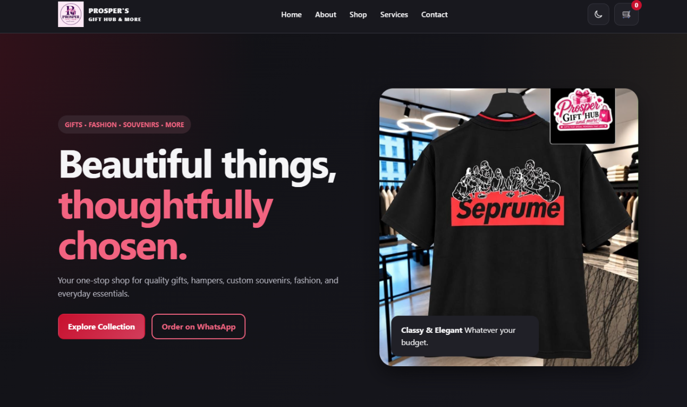

<div align="center">

# Prosper's Gift Hub and More

### Thoughtful gifts, fashion, souvenirs, and everyday finds.

[](https://developer.mozilla.org/docs/Web/HTML)
[](https://developer.mozilla.org/docs/Web/CSS)
[](https://developer.mozilla.org/docs/Web/JavaScript)
[](https://formspree.io/)

<br />

**A modern, responsive storefront for discovering gifts, fashion, hampers, custom souvenirs, and more.**

</div>

---

## Website Preview

<p align="center">
  
</p>

---

## About the Project

Prosper's Gift Hub and More is a static e-commerce and gifting website for a Nigerian gifting and souvenir brand. It brings the brand story, product browsing, service highlights, and customer contact options together in one storefront.

Visitors can explore fashion and gift products by category, add products to a cart, and prepare an order message for WhatsApp. The site also offers a Formspree-powered contact form and direct email, phone, and WhatsApp links, making it easy to ask questions or place an order.

## Features

- **Responsive storefront** with layouts adapted for desktop, tablet, and mobile.
- **Product catalogue** with category filters for clothes, men's and women's wear, bags, shoes, jewellery, gifts, and souvenirs.
- **Shopping cart** with quantity controls, item removal, and an estimated total.
- **WhatsApp ordering** from the hero and contact section, plus cart checkout that formats the selected items into a message.
- **Contact form** submitted through the Formspree endpoint configured in the page.
- **Direct contact options** via WhatsApp, email, and telephone.
- **Light and dark themes** with the selection saved in the browser when storage is available.
- **Mobile navigation menu** that expands and closes when a section link is selected.
- **Motion and interaction details**, including product filtering, scroll reveals, and reduced-motion support.
- **Gift, fashion, souvenir, and nationwide-delivery service highlights.**

## Technology Stack

| Technology | Use |
| --- | --- |
| HTML5 | Page structure, product catalogue, and contact form |
| CSS3 | Responsive layouts, visual design, themes, and animations |
| Vanilla JavaScript | Product filters, cart, theme control, navigation, and form interactions |
| Formspree | Contact form submission endpoint |
| Git & GitHub | Source control and project hosting |

This project does not require a JavaScript framework, package manager, or build step.

## Project Structure

```text
PROSPER'S-GIFT-HUB/
├── images/
│   ├── about.jpeg
│   ├── hero.jpeg
│   ├── logo.png
│   └── product*.jpg       # Product photography
├── screenshots/
│   └── website-preview.png
├── index.html              # Page content and product catalogue
├── script.js               # Interactive behavior
├── style.css               # Responsive design and themes
└── README.md
```

## Getting Started

### Requirements

- Git
- A modern web browser
- Optionally, Python 3 if you want to serve the site from a local HTTP server

### Clone the repository

```bash
git clone https://github.com/MayorKay01/Prosper-s-Gift-Hub-.git
cd Prosper-s-Gift-Hub-
```

### Run the website

There is no dependency installation or build step. You can open `index.html` directly in a browser, or start a local server from the project directory:

```bash
python -m http.server 8000
```

Then visit [http://localhost:8000](http://localhost:8000).

### Contact form configuration

The contact form is connected to Formspree in `index.html`. To use a different Formspree form, replace the form's `action` URL with the endpoint provided by your Formspree account. No additional client-side setup is required.

## Design Highlights

- **Warm, polished brand palette:** rich red and coral-pink accents paired with soft cream surfaces, with complementary dark-theme colours.
- **Product-first presentation:** prominent imagery, concise product cards, clear category filters, and visible add-to-cart actions.
- **Responsive by design:** the navigation, hero, product grid, service cards, and contact layout adapt to narrower screens.
- **Comfortable interactions:** clear buttons and focus states, subtle transitions, scroll reveals, and support for reduced-motion preferences.
- **Consistent shopping journey:** discover products, review the cart, and continue the order through WhatsApp.

## Developer Credit

<div align="center">

**Designed and Developed by Mayor_Kay**

[](https://github.com/MayorKay01-spec)

</div>

---

<div align="center">

**Prosper's Gift Hub and More** · Classy & elegant, whatever your budget.

</div>
